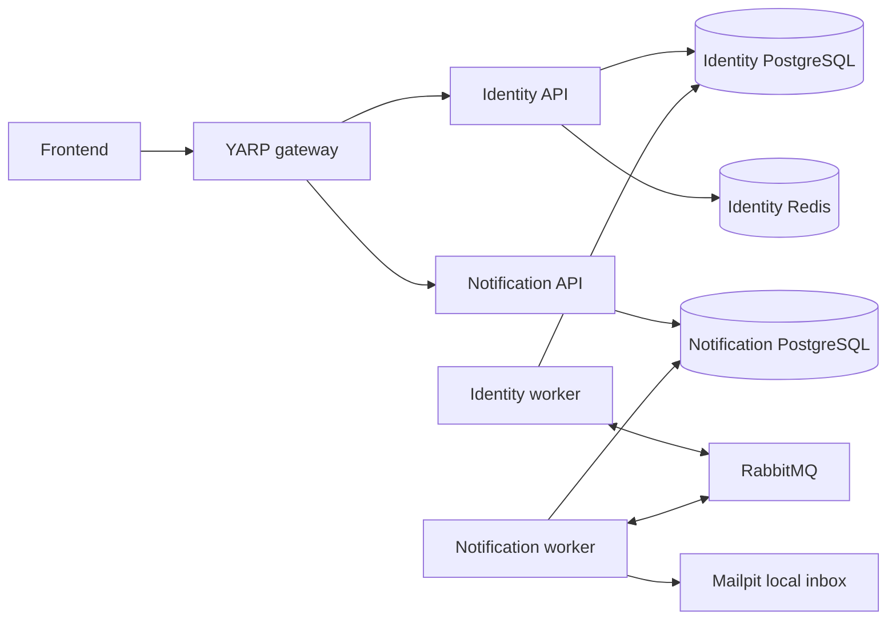

# Run DevFlow locally with Docker

Follow this guide from top to bottom for your first setup. It starts Identity and
Notification entirely in Docker, with a local email inbox. You need Git and
Docker; the .NET SDK, PostgreSQL, Redis, and RabbitMQ run inside containers.

Choose **Windows PowerShell** or **Linux Bash** and use that platform's command
blocks throughout. Run commands individually and check their results before the
next command. All project commands below run from the repository root.

## Contents

1. [Understand what will run](#1-understand-what-will-run)
2. [Install and check the tools](#2-install-and-check-the-tools)
3. [Open the repository](#3-open-the-repository)
4. [Prepare your local environment file](#4-prepare-your-local-environment-file)
5. [Generate local credentials](#5-generate-local-credentials)
6. [Validate and start the project](#6-validate-and-start-the-project)
7. [Check that setup succeeded](#7-check-that-setup-succeeded)
8. [Use the project each day](#8-use-the-project-each-day)
9. [Troubleshoot and ask for help](#9-troubleshoot-and-ask-for-help)

## 1. Understand what will run

An **API** accepts HTTP requests. A **worker** processes background work. A
**migration job** creates or updates database tables before the applications start.
The setup scripts run migrations for you.



Identity owns account data and registration. Notification owns email jobs and
provider callbacks. Each module has its own database, API, worker, and migration
job; its API and worker share that module's database. RabbitMQ carries messages
between workers. Redis supports Identity's registration rate limits. Mailpit
captures local email instead of delivering it to real recipients.

Gateway is the frontend API entry point at `http://localhost:8080`, publishing
`POST /identity/api/v1/auth/register` and the signed Notification callback.
Direct loopback API ports remain available to developer tools. Tasks is outside
this deployment. No frontend application starts here. Registration stages encrypted
verification email for the independently running workers; Mailpit captures local
delivery. See [gateway operations](gateway/README.md).

| Term | Meaning in this guide |
| --- | --- |
| Image | A packaged application or tool used to create containers. Local setup builds DevFlow images from your checkout. |
| Container | A running instance of an image, such as the Identity API or its database. |
| Volume | Docker-managed storage that survives container replacement and ordinary shutdown. |
| Compose project | A named group of containers, networks, and volumes. DevFlow has platform, gateway, Identity, and Notification projects. |
| Environment file | A local text file containing settings such as ports and image names. |
| Secret | A password, signing key, or private key stored separately from the environment file. |
| Host | Your computer, where the browser and terminal run. Container names such as `postgres` are internal Docker addresses. |

**Checkpoint:** expect a gateway, two APIs, and two workers, supported by two PostgreSQL
containers, Redis, RabbitMQ, and Mailpit. Setup jobs run briefly and exit.

## 2. Install and check the tools

### Windows PowerShell

1. Install [Git](https://git-scm.com/downloads/), then reopen your terminal.
2. Follow the official [Docker Desktop for Windows installation guide](https://docs.docker.com/desktop/setup/install/windows-install/).
   Use its supported Windows version and enable hardware virtualization if the
   installer requires it. Use the WSL 2 backend for this walkthrough.
3. If WSL is missing, follow Microsoft's [WSL installation instructions](https://learn.microsoft.com/en-us/windows/wsl/install).
   The initial installation can require an administrator terminal and a restart.
   Finish that installation and restart when instructed before continuing.
4. Start Docker Desktop and wait until its engine is running. Select **Linux
   containers** if you are offered a container-mode choice.
5. Open a normal Windows PowerShell terminal, version 5.1 or later. Continue the
   Windows walkthrough there; opening a WSL terminal is not required.

These project commands use a per-invocation execution-policy option so local
unsigned scripts can run without changing your machine-wide PowerShell policy.
On a managed computer, contact your mentor if organizational policy still blocks them.

### Linux Bash

1. Install Git through your distribution's package manager.
2. Follow the official [Docker Engine installation instructions](https://docs.docker.com/engine/install/)
   for your distribution, including the Buildx plugin.
3. Install the [Docker Compose plugin](https://docs.docker.com/compose/install/linux/).
4. Start Docker and configure your development account's access using your team's
   approved Docker setup. Resolve Docker permission errors before running the
   project scripts; running the whole walkthrough as root can create ownership problems.
5. Use Bash 4 or later and GNU tools including `stat`, `base64`, and `coreutils`.
   Install `curl` for the HTTP checks below.

If following this branch inside WSL, use a checkout in that Linux environment and
confirm Docker integration works there. Keep configuration, generated secrets, and
commands in the same environment rather than switching between PowerShell and WSL.

### Check both installations

Run these commands in your chosen terminal:

```text
git --version
docker version
docker compose version
docker buildx version
docker info --format '{{.OSType}}'
```

Expected results: Git prints a version; Docker prints **Client and Server**
sections; Compose is **2.24.4 or later**; Buildx prints a version; the final command
prints **linux**. A newer Compose major version is acceptable. A Docker Client
version alone does not confirm that the engine is running.

Allow at least **8 GiB available to Docker** for the basic workflow, and around
**12 GiB** when also building with telemetry enabled. Four or more CPU cores help
builds. Leave free disk space for downloaded images, build cache, and database
volumes; these accumulate over time. These are starting budgets, not measured
production requirements; see [resource budgets](../deploy/README.md#resource-budgets).
On Windows with WSL 2, confirm the WSL VM can access the required memory using
your team's Docker/WSL configuration.

You need internet access for image downloads and NuGet package restore during
builds. Registration checks passwords locally; it makes no external breach lookup.

**Checkpoint:** every tool check succeeds and Docker reports Linux containers.

## 3. Open the repository

Ask your mentor for the repository URL and access. If you have no checkout yet,
replace `REPOSITORY_URL_FROM_YOUR_TEAM` below with that URL. Do not paste access
tokens into the command; use the team's Git authentication method.

**Windows PowerShell or Linux Bash:**

```text
git clone REPOSITORY_URL_FROM_YOUR_TEAM Task-Management
cd Task-Management
```

If you already have the repository, open a terminal in its existing directory
instead. For example, on Windows:

```powershell
Set-Location 'D:\SourceCode\Personal\Task-Management'
```

Your own checkout may be elsewhere. Confirm the root:

**Windows PowerShell:**

```powershell
Get-Location
Test-Path ./DevFlow.slnx
Test-Path ./scripts/devflow.ps1
git status --short
```

**Linux Bash:**

```bash
pwd
test -f ./DevFlow.slnx && echo 'Solution found'
test -f ./scripts/devflow.sh && echo 'Entry point found'
git status --short
```

**Checkpoint:** Windows prints `True` for both paths, or Linux prints both
confirmation messages. Keep existing uncommitted changes; ask your mentor if they
are unfamiliar. The paths in the rest of this guide are relative to this root.

## 4. Prepare your local environment file

### Create the file once

Copy the checked-in example only if your local file does not exist. This lets you
review settings before generating credentials.

**Windows PowerShell:**

```powershell
if (-not (Test-Path -LiteralPath ./deploy/env/local.env)) {
    Copy-Item -LiteralPath ./deploy/env/local.env.example -Destination ./deploy/env/local.env
}
notepad ./deploy/env/local.env
```

**Linux Bash:**

```bash
if [[ ! -e ./deploy/env/local.env ]]; then
  cp ./deploy/env/local.env.example ./deploy/env/local.env
fi
```

Open `deploy/env/local.env` in your editor on Linux. Save changes as plain text
using UTF-8 without a BOM. Existing local files are preserved by these commands.

For a normal first setup, **keep all example values**. Nothing requires a personal
password, cloud account, or Resend API key. If ports conflict, use the example
below. If a previous setup already has data, keep its stack name, secret directory,
and credentials together; ask your mentor before changing them.

Keeping the defaults? Save the file and continue to [step 5](#5-generate-local-credentials).
The tables below are a reference for when you need to understand or change a setting.

### File rules

Use literal, unquoted `KEY=value` lines. For example:

```dotenv
DEVFLOW_IDENTITY_API_PORT=8081
DEVFLOW_FRONTEND_ORIGIN=http://localhost:3000
DEVFLOW_EMAIL_SENDER=DevFlow <auth@example.test>
```

Keep each key once, with no spaces around `=`. Use separate full-line comments
starting with `#`; omit inline comments, shell expressions, and quotes around
values. Save settings in `local.env`, not in the checked-in example. The onboarding
scripts load the file automatically on each invocation; you do not need to export
variables manually or edit Windows system environment variables.

The file holds **settings only**. Credentials belong in generated secret files
under `deploy/secrets/`. Both local `.env` files and that directory are ignored by
Git. Never paste credentials into screenshots, shared logs, or this document.

### Stack identity and application settings

| Setting | Default | Purpose / when to change |
| --- | --- | --- |
| `DEVFLOW_STACK` | `devflow-local` | Prefix for Docker project/storage names. Keep it stable. A second independent checkout needs a distinct name starting with `devflow-` and distinct ports. |
| `DEVFLOW_ENVIRONMENT` | `Development` | Required by local setup. Keep this value. |
| `DEVFLOW_SECRETS_DIR` | `deploy/secrets/devflow-local` | Credential source directory, relative to the repository root. Choose a separate directory before initialization if creating another independent stack. |
| `DEVFLOW_FRONTEND_ORIGIN` | `http://localhost:3000` | Allowed browser origin and email-link origin. Change only to your team's actual frontend origin, without a path, query, or trailing route. It does not start a frontend. |
| `DEVFLOW_JWT_ISSUER` | `DevFlow.Identity` | Token issuer identifier. Keep the team's default. |
| `DEVFLOW_JWT_AUDIENCE` | `DevFlow` | Token audience identifier. Keep the team's default. |

### Ports published on your computer

All these listeners bind to `127.0.0.1`, so they are local to your computer. Choose
unused, distinct ports from 1–65535 when changing them.

| Setting | Default | Used by |
| --- | --- | --- |
| `DEVFLOW_IDENTITY_API_PORT` | `8081` | Identity HTTP requests and readiness URL. |
| `DEVFLOW_NOTIFICATION_API_PORT` | `8082` | Notification HTTP requests and readiness URL. |
| `DEVFLOW_IDENTITY_POSTGRES_PORT` | `15431` | Optional host database client for Identity. |
| `DEVFLOW_NOTIFICATION_POSTGRES_PORT` | `15432` | Optional host database client for Notification. |
| `DEVFLOW_REDIS_PORT` | `16379` | Optional host Redis client. |
| `DEVFLOW_RABBITMQ_AMQP_PORT` | `5672` | Host applications connecting to RabbitMQ. |
| `DEVFLOW_RABBITMQ_MANAGEMENT_PORT` | `15672` | RabbitMQ management website. |
| `DEVFLOW_MAILPIT_SMTP_PORT` | `11025` | Host applications submitting mail to Mailpit. |
| `DEVFLOW_MAILPIT_HTTP_PORT` | `18025` | Mailpit inbox website. |

Containers talk to each other using internal names and ports, such as
`rabbitmq:5672` or `postgres:5432`. A host publication such as `15431` forwards
traffic from your computer into a container. Changing that publication does not
change PostgreSQL's internal port or require editing application connection strings.

### Messaging and local email

| Setting | Default | Purpose / when to change |
| --- | --- | --- |
| `DEVFLOW_MESSAGING_HOST` | `rabbitmq` | Broker's internal Docker name. Keep this for the bundled local broker. |
| `DEVFLOW_MESSAGING_PORT` | `5672` | Broker's internal AMQP port. Keep it even if changing the host AMQP publication. |
| `DEVFLOW_MESSAGING_VIRTUAL_HOST` | `/devflow-local` | Broker namespace shared by this stack's workers. Keep it for the basic setup. |
| `DEVFLOW_MESSAGING_DEVELOPMENT` | `true` | Explicit local development mode. Keep it. |
| `DEVFLOW_MESSAGING_USE_TLS` | `false` | Local broker connection setting. Keep it; production has separate requirements. |
| `DEVFLOW_MESSAGING_QUORUM_SIZE` | `1` | Local broker queue setting for one node. Keep it. |
| `DEVFLOW_EMAIL_MODE` | `Mailpit` | Capture local email in Mailpit. Keep this; real-provider sending is an advanced workflow. |
| `DEVFLOW_EMAIL_SENDER` | `DevFlow <auth@example.test>` | Local sample sender. Keep it for this walkthrough. |
| `DEVFLOW_EMAIL_DOMAIN_VERIFIED` | `false` | Real-provider verification flag. Leave false locally. |

### Application and setup images

These names are local build outputs. Keep their values; `up` builds them from
your checkout automatically. You do not need access to a private image registry.

| Setting | Default | Contains |
| --- | --- | --- |
| `DEVFLOW_SETUP_IMAGE` | `devflow-setup:local` | Initialization, secret staging, and database/broker setup tools. |
| `DEVFLOW_IDENTITY_API_IMAGE` | `devflow-identity-api:local` | Identity HTTP host. |
| `DEVFLOW_IDENTITY_WORKER_IMAGE` | `devflow-identity-worker:local` | Identity background host. |
| `DEVFLOW_IDENTITY_MIGRATION_IMAGE` | `devflow-identity-migration:local` | Identity database migration runner. |
| `DEVFLOW_NOTIFICATION_API_IMAGE` | `devflow-notification-api:local` | Notification HTTP host. |
| `DEVFLOW_NOTIFICATION_WORKER_IMAGE` | `devflow-notification-worker:local` | Notification background host. |
| `DEVFLOW_NOTIFICATION_MIGRATION_IMAGE` | `devflow-notification-migration:local` | Notification database migration runner. |

Keep the following base-image references **exactly as supplied by
`deploy/env/local.env.example`**, including their digest after `@sha256:`. The
template is authoritative for reviewed versions; copying long digests into this
guide would create another version list to maintain.

| Setting | Image purpose | Action |
| --- | --- | --- |
| `DEVFLOW_DOTNET_SDK_IMAGE` | Build the .NET applications inside Docker. | Keep the template reference. |
| `DEVFLOW_DOTNET_RUNTIME_IMAGE` | Run the built .NET hosts. | Keep the template reference. |
| `DEVFLOW_POSTGRES_IMAGE` | Both module database containers and setup-image base. | Keep the template reference. |
| `DEVFLOW_REDIS_IMAGE` | Identity Redis. | Keep the template reference. |
| `DEVFLOW_RABBITMQ_IMAGE` | Local RabbitMQ with management UI. | Keep the template reference. |
| `DEVFLOW_MAILPIT_IMAGE` | Local SMTP capture and inbox UI. | Keep the template reference. |

### Optional telemetry settings

Telemetry means diagnostic logs, metrics, and traces collected in additional
containers. It is **off** in the basic walkthrough; leave these template values
unchanged. Merely having them in the file does not start telemetry.

| Setting | Default / source | Purpose |
| --- | --- | --- |
| `DEVFLOW_GRAFANA_PORT` | `13000` | Optional Grafana website. |
| `DEVFLOW_OTLP_PORT` | `4317` | Optional host telemetry input over gRPC. |
| `DEVFLOW_OTLP_HTTP_PORT` | `4318` | Optional host telemetry input over HTTP. |
| `DEVFLOW_COLLECTOR_IMAGE` | Reference in the local example. | Collect and route telemetry. |
| `DEVFLOW_GRAFANA_IMAGE` | Reference in the local example. | Display diagnostic dashboards. |
| `DEVFLOW_LOKI_IMAGE` | Reference in the local example. | Store logs. |
| `DEVFLOW_TEMPO_IMAGE` | Reference in the local example. | Store traces. |
| `DEVFLOW_PROMETHEUS_IMAGE` | Reference in the local example. | Store metrics. |

The entry point derives `DEVFLOW_OBSERVABILITY_ENABLED` from the telemetry command
option; do not add it manually. Optional tuning variables absent from the template,
and the complete application/secret mapping, are in the
[environment reference](../deploy/ENVIRONMENT.md).

### Example: resolve an occupied Identity HTTP port

If another application uses `8081`, edit the existing line in `local.env` to:

```dotenv
DEVFLOW_IDENTITY_API_PORT=18081
```

Use this URL afterwards: `http://localhost:18081/health/ready`. Other service ports
remain unchanged. After generating credentials in step 5, validate the edit:

**Windows PowerShell:**

```powershell
powershell -NoProfile -ExecutionPolicy Bypass -File ./scripts/devflow.ps1 check
```

**Linux Bash:**

```bash
bash ./scripts/devflow.sh check
```

Then use step 6's `up` command to apply it. The same sequence applies to other
published ports. Do not stop an unfamiliar process just to free a port.

**Checkpoint:** your saved `local.env` exists, contains settings without
credentials, and keeps defaults except deliberate local changes.

## 5. Generate local credentials

If this checkout already has retained database data but its credentials are
missing, stop here. Ask your mentor to recover the matching material using the
[recovery guidance](../deploy/OPERATIONS.md#backups-and-restore). Generating new
passwords does not update an existing database or recover encrypted pending jobs.

For a new setup, run:

**Windows PowerShell:**

```powershell
powershell -NoProfile -ExecutionPolicy Bypass -File ./scripts/devflow.ps1 init
```

**Linux Bash:**

```bash
bash ./scripts/devflow.sh init
```

This first builds the setup image, then generates missing local credentials. It
can download images and packages. Expected completion messages include
`Deployment secrets initialized; existing files were preserved.` and
`Configuration ready: ...`. If the command fails, use step 9 before continuing.

With default settings, generated files have this structure (names only):

```text
deploy/secrets/devflow-local/
  platform/
    broker-admin-password.secret
    identity-broker-password.secret
    notification-broker-password.secret
    grafana-admin-password.secret
  identity/
    admin-password.secret
    migrator-password.secret
    api-password.secret
    worker-password.secret
    redis-password.secret
    registration-hmac.secret
    jwt-key.secret
    integration-key.secret
  notification/
    admin-password.secret
    migrator-password.secret
    runtime-password.secret
    keys/
      local-v1.public.pem
      local-v1.private.pem
      recipient-hmac.secret
      resend-api.secret
      resend-webhook.secret
```

The two Resend files are intentionally empty while using Mailpit. Database,
broker, and application credentials have separate purposes. You do not need to
open, copy, or type them to run the basic setup. Runtime containers receive
restricted copies of only their assigned runtime material.

`init` preserves existing files; it creates missing ones. Keep the generated
directory for future starts. Replacing a password file alone does not rotate a
database or broker password. An incomplete RSA pair requires recovery rather
than regeneration. Follow the [rotation procedure](../deploy/OPERATIONS.md#credential-and-encryption-key-rotation)
with your mentor when needed.

On Linux, initialization creates files with restricted permissions. Keep them
owned by your development account and inaccessible to other users; `check`
rejects world-readable secrets. Never use `chmod 777` to fix a permission issue.
Source files stay on your computer; startup stages runtime-owned, read-only mounts
for the containers.

You can confirm Git ignores the generated locations without printing credentials:

```text
git check-ignore deploy/env/local.env deploy/secrets/devflow-local/identity/jwt-key.secret
```

Both paths should be printed. Adapt the second path if you chose a different
secret directory. If Git does not ignore a credential path, stop and ask your
mentor before committing anything.

**Checkpoint:** `init` exits successfully and the selected secret directory exists.

## 6. Validate and start the project

### Validate before starting

**Windows PowerShell:**

```powershell
powershell -NoProfile -ExecutionPolicy Bypass -File ./scripts/devflow.ps1 check
```

**Linux Bash:**

```bash
bash ./scripts/devflow.sh check
```

Expected: a message that configuration, Compose models, secrets, and selected port
bindings passed preflight. This command does not start the application. Correct
any reported problem before proceeding.

### Start both modules

**Windows PowerShell:**

```powershell
powershell -NoProfile -ExecutionPolicy Bypass -File ./scripts/devflow.ps1 up
```

**Linux Bash:**

```bash
bash ./scripts/devflow.sh up
```

The script builds local images, prepares RabbitMQ permissions and topology,
starts Mailpit, then initializes each module's database, runs migrations, applies
runtime grants, and starts its API and worker. Identity also starts Redis.

The first build can take several minutes depending on your network and computer;
later builds reuse cache. Keep the terminal open until the command returns. A
failure returns a nonzero exit code; in PowerShell inspect `$LASTEXITCODE`, or in
Bash run `echo $?` immediately after the command. Stop at a failure and inspect
its diagnostic instead of continuing through later steps.

Expected final message:

```text
Selected modules ready (local/docker). Existing data and credentials were preserved.
```

### Inspect status

**Windows PowerShell:**

```powershell
powershell -NoProfile -ExecutionPolicy Bypass -File ./scripts/devflow.ps1 status
```

**Linux Bash:**

```bash
bash ./scripts/devflow.sh status
```

With defaults, project names start with `devflow-local-platform`,
`devflow-local-identity`, and `devflow-local-notification`. APIs, workers, databases,
Redis, and RabbitMQ should be running and healthy; Mailpit should also be running.
No telemetry containers are needed for this workflow.

Completed setup jobs may show **Exited (0)**. This is normal for one-shot jobs
such as secret staging. Other jobs use temporary containers removed after success,
so a successful migration need not remain in the status list. A runtime repeatedly
restarting, an unhealthy runtime, or a job that exited nonzero needs investigation.

**Checkpoint:** `up` finishes successfully and both modules' runtime containers
are running and healthy.

## 7. Check that setup succeeded

Use your configured ports if you changed them. These commands show the HTTP status:

**Windows PowerShell:**

```powershell
(Invoke-WebRequest -UseBasicParsing -Uri http://localhost:8081/health/ready -TimeoutSec 10).StatusCode
(Invoke-WebRequest -UseBasicParsing -Uri http://localhost:8082/health/ready -TimeoutSec 10).StatusCode
```

**Linux Bash:**

```bash
curl --fail --silent --show-error --output /dev/null --write-out '%{http_code}\n' http://localhost:8081/health/ready
curl --fail --silent --show-error --output /dev/null --write-out '%{http_code}\n' http://localhost:8082/health/ready
```

Both should print **200**. Open <http://localhost:18025> in your browser to see the
Mailpit inbox. It should load without needing a real email-provider account.

| Service | Default host endpoint | What to expect |
| --- | --- | --- |
| Identity readiness | <http://localhost:8081/health/ready> | HTTP 200 after the database check passes. |
| Notification readiness | <http://localhost:8082/health/ready> | HTTP 200 after the database check passes. |
| Mailpit inbox | <http://localhost:18025> | Inbox page; no messages is normal on a fresh setup. |
| RabbitMQ management | <http://localhost:15672> | Login page. Optional inspection only; the local administrator username is `devflow-admin`, with its password in `platform/broker-admin-password.secret` under the selected secret directory. |
| Identity PostgreSQL | `127.0.0.1:15431` | Optional database-client endpoint; not a browser URL. |
| Notification PostgreSQL | `127.0.0.1:15432` | Optional database-client endpoint; not a browser URL. |
| Identity Redis | `127.0.0.1:16379` | Authenticated Redis endpoint; not a browser URL. |

Keep credentials local if inspecting optional tools. Applications already have
their database/broker settings; no manual SQL, grants, or migrations are required.
An API's `/` route may return 404; use the explicit readiness URLs above.

Readiness checks database connectivity. Worker health checks a recent successful
outbox scan. Neither proves every business dependency or delivery outcome. In
particular, an empty Mailpit inbox is expected because registration-to-email
wiring is still pending. Synthetic delivery and receipt tests are an advanced
workflow linked below.

### Completion checklist

- [ ] Git and Docker checks pass; Docker reports `linux`.
- [ ] The local environment file is saved and ignored by Git.
- [ ] Local secret files exist, are ignored, and have been retained.
- [ ] `check` and `up` complete successfully.
- [ ] Both APIs and both workers are running and healthy.
- [ ] Both readiness URLs return HTTP 200.
- [ ] The Mailpit inbox opens, even if empty.
- [ ] You know how to view logs and stop the deployment using step 8.

## 8. Use the project each day

### Start again or apply pulled changes

From the repository root, check your working changes before pulling. Resolve Git
conflicts with your mentor if needed. After pulling or deliberately changing local
settings, run `check` followed by `up` again:

**Windows PowerShell:**

```powershell
git status --short
git pull --ff-only
powershell -NoProfile -ExecutionPolicy Bypass -File ./scripts/devflow.ps1 check
powershell -NoProfile -ExecutionPolicy Bypass -File ./scripts/devflow.ps1 up
```

**Linux Bash:**

```bash
git status --short
git pull --ff-only
bash ./scripts/devflow.sh check
bash ./scripts/devflow.sh up
```

If Git fails, resolve that failure before continuing. To start an unchanged
checkout, run only `check` and `up`. The `up` command builds changed images and
runs a new migration process before replacing runtimes. Retained data and existing
credentials are reused. You do not need to repeat `init` for an ordinary restart.

### View logs or operate one module

**Windows PowerShell:**

```powershell
powershell -NoProfile -ExecutionPolicy Bypass -File ./scripts/devflow.ps1 logs
powershell -NoProfile -ExecutionPolicy Bypass -File ./scripts/devflow.ps1 logs -Module notification
powershell -NoProfile -ExecutionPolicy Bypass -File ./scripts/devflow.ps1 up -Module identity
```

**Linux Bash:**

```bash
bash ./scripts/devflow.sh logs
bash ./scripts/devflow.sh logs --module notification
bash ./scripts/devflow.sh up --module identity
```

Logs show the latest 100 lines for platform and selected module containers.
Redeploying Identity leaves Notification's runtime containers alone, and vice
versa. Shared prerequisites may be checked again. Use `notification` instead of
`identity` to operate that module.

### Stop when finished

**Windows PowerShell:**

```powershell
powershell -NoProfile -ExecutionPolicy Bypass -File ./scripts/devflow.ps1 down
```

**Linux Bash:**

```bash
bash ./scripts/devflow.sh down
```

This stops and removes the selected containers; with default selection it includes
both modules, platform/Mailpit, and any optional telemetry containers. Named volumes
and source secrets stay intact for the next `up`.

To stop just one module, append `-Module identity` on Windows or
`--module identity` on Linux. This leaves platform and the other module running.
Do not delete volumes or secret files to resolve a routine startup problem.

### Optional: enable telemetry

Allow the additional resource budget from step 2, then run:

**Windows PowerShell:**

```powershell
powershell -NoProfile -ExecutionPolicy Bypass -File ./scripts/devflow.ps1 check -Telemetry
powershell -NoProfile -ExecutionPolicy Bypass -File ./scripts/devflow.ps1 up -Telemetry
```

**Linux Bash:**

```bash
bash ./scripts/devflow.sh check --telemetry
bash ./scripts/devflow.sh up --telemetry
```

Grafana is at <http://localhost:13000> by default. Repeat the telemetry option on
later `up` commands to keep application export enabled. Omitting it on a later
`up` disables application export but does not remove already running telemetry
containers; a full `down` stops everything. See the
[telemetry guide](../deploy/observability/README.md) for dashboard access and details.

### Separate configuration or advanced workflows

If your mentor gives you a separate configuration file, use it consistently for
every lifecycle command, including `init`, `check`, `up`, `status`, and `down`:

**Windows PowerShell example:**

```powershell
powershell -NoProfile -ExecutionPolicy Bypass -File ./scripts/devflow.ps1 status -Config deploy/env/my-local.env
```

**Linux Bash example:**

```bash
bash ./scripts/devflow.sh status --config deploy/env/my-local.env
```

A second independent stack needs its own stack name, secret directory, and ports.
Relative configuration paths resolve against the repository root. The default
file remains `deploy/env/local.env` when no option is supplied.

- For running applications from an IDE, use the separate
  [host development workflow](../deploy/README.md#developer-workflows); it requires
  a host .NET SDK and stopping the selected Docker-hosted applications first.
- For synthetic encrypted delivery, receipt, and permission checks, see
  [acceptance testing](../deploy/OPERATIONS.md#acceptance-evidence). Those tests
  require a dedicated disposable configuration and additional tools.
- For all configuration and secret names, see the
  [environment reference](../deploy/ENVIRONMENT.md).
- For rotation, backups, and legacy-data recovery, use the
  [operations guide](../deploy/OPERATIONS.md) with your mentor.

## 9. Troubleshoot and ask for help

Start with the first failed command. Use `status` and `logs` from step 8 after a
startup failure. Avoid posting full resolved configuration, environment dumps,
secret-file contents, or raw request payloads in chat or tickets.

| Symptom | Check | Corrective action |
| --- | --- | --- |
| `docker` or `git` is not recognized | Tool checks in step 2. | Complete installation and reopen the terminal so its PATH refreshes. |
| Cannot connect to Docker, or no Server section | Docker Desktop/Engine state and `docker version`. | Start Docker, wait for readiness, and check the selected Docker context with your mentor. |
| Docker socket permission denied on Linux | Your account's Docker access. | Follow the team's approved Docker access procedure; reopen the session if required. Avoid creating the project setup as root. |
| Image platform/container-mode error | `docker info --format '{{.OSType}}'`. | Select Linux containers. If your CPU platform is unsupported by an image, ask your mentor to review supported images. |
| PowerShell script execution is blocked | Whether you used the full command with `-ExecutionPolicy Bypass`. | Use this guide's per-invocation command. If organization policy still rejects it, contact your mentor/IT. |
| Wrong path or solution file missing | Step 3's root-directory checks. | Change to the checkout root before running relative commands. |
| Configuration file is missing | Whether step 4 created `deploy/env/local.env`, or a custom `-Config`/`--config` was used. | Prepare the intended local file and keep using that same configuration path. |
| Duplicate key, placeholder, or invalid port | The named setting in `local.env`. | Keep one literal unquoted value per key, remove placeholder values, and use valid distinct ports. Save the file and rerun `check`. |
| Port is occupied | The setting named by `check`; whether another checkout uses it. | Choose an unused host port as shown in step 4. Update the URL you use, then run `check` and `up`. |
| Required secret is missing or empty | Whether `init` completed, the selected secret directory, and whether this stack has retained data. | For a fresh setup, finish `init`. With retained data, recover original credentials with your mentor before proceeding. Empty Resend placeholders are normal in Mailpit mode. |
| Secret permissions fail on Linux | Ownership and permissions of the named file, using `ls -l` (not `cat`). | Have your mentor restore your account's ownership and restricted access. Keep secrets off a shared/world-readable location. |
| Incomplete encryption pair | The initialization error names the RSA pair. | Recover its matching pair; preserve existing material and pending jobs. |
| Image download, package restore, or certificate error | Docker's network access, VPN/proxy, free disk space, and the first error. | Restore access using team-approved network/certificate settings, then retry the failed command. Keep TLS validation enabled. |
| Build cache reports a missing snapshot | The first BuildKit error mentions `failed to stat parent` or a missing snapshot path. | Follow the [isolated-builder procedure](../deploy/OPERATIONS.md#recover-from-a-missing-docker-build-snapshot), then rerun `check` and `up`. The fresh builder needs additional download time and disk space. |
| Database bootstrap or migration fails | Failed job output and selected stack/credential paths. | Stop rollout, retain data, and ask your mentor to inspect the owning module's database/migration. Rerunning `up` after correction reruns migrations. |
| Worker is unhealthy or keeps restarting | Worker logs, database and RabbitMQ status. | Resolve the named dependency/configuration failure and rerun `up`; a running process alone is insufficient. |
| Setup job shows `Exited (0)` | Whether it is a one-shot setup job or an API/worker. | Successful setup-job exit is expected. Investigate nonzero exits or exited runtime containers. |
| Browser gets 404 at `/` | The URL path. | Use `/health/ready` for readiness; a root webpage is not part of these APIs. |
| Registration returns 503 | Identity logs and Redis health. | Restore the unavailable dependency; registration rate limiting fails closed if Redis is unavailable. |
| Registration returns 400 or 429 | Request validation or rate-limit response. | Correct input or wait for the rate-limit window. These responses do not necessarily indicate a deployment failure. |
| Mailpit is empty | Whether any actual delivery job was submitted. | A fresh inbox and registration without email are expected; use mentor-led synthetic acceptance testing when needed. |

### Information to send your mentor

Provide the following after reviewing it for sensitive information:

- Windows/Linux and terminal type, plus Git, Docker, and Compose versions.
- Repository commit (`git rev-parse --short HEAD`) and whether local source changes exist.
- The exact lifecycle command that failed, its exit code, and the first error.
- Configuration filename, stack name, and any port changes; keep credentials private.
- `status` output and a small relevant excerpt from `logs`, with sensitive data redacted.
- Whether this is a fresh setup or a restart with retained data and credentials.

If a command fails before application containers exist, include its initialization
or build error rather than searching for application logs that do not exist yet.

## Verification record

Reviewed on **2026-10-27** against the current onboarding scripts and local
environment template, using Docker 29.5.2 and Compose 5.1.4 on Windows.

- A fresh disposable stack completed `init`, `check`, `up`, and `status`. Port
  `8081` was unavailable, so the documented change to `18081` was exercised;
  remaining published ports kept their defaults. Separate stack/configuration
  names and a secret directory isolated verification from existing setups.
- Both readiness URLs and Mailpit returned HTTP 200. Repeat startup, full shutdown,
  and restart passed. Credentials and the PostgreSQL system identifier were
  unchanged after restart. Final shutdown left volumes/secrets intact and removed
  the verification containers, including Mailpit.
- All 45 variables in the local template are covered. Relative links, anchors,
  Markdown fences, and 14 PowerShell / 13 Bash command blocks passed static checks.
  Bash syntax checks ran inside a Linux container.

The Windows run used an existing checkout, installed tools, and the isolated
Buildx builder described in the operations guide; fresh OS installation and
cloning were not rehearsed. Automatic approval review rejected the Linux runtime
rehearsal command with a policy restriction and no more specific reason. A fresh
Linux installation/startup walkthrough remains unexecuted for this revision;
earlier deployment tests are not counted as this guide's validation.
