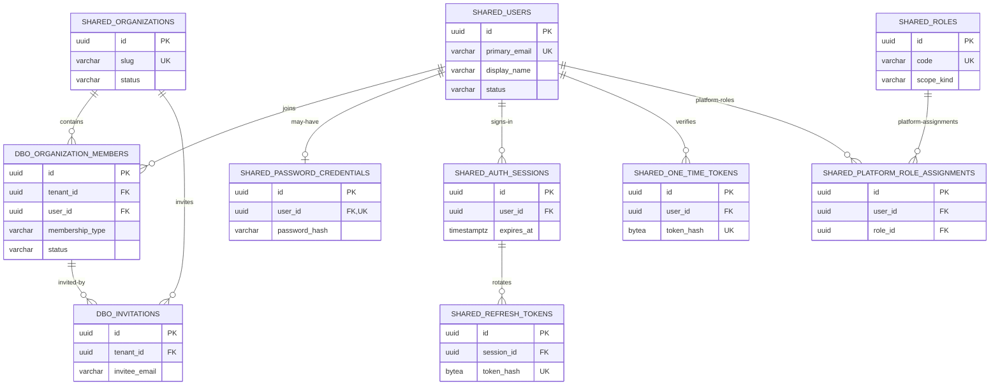
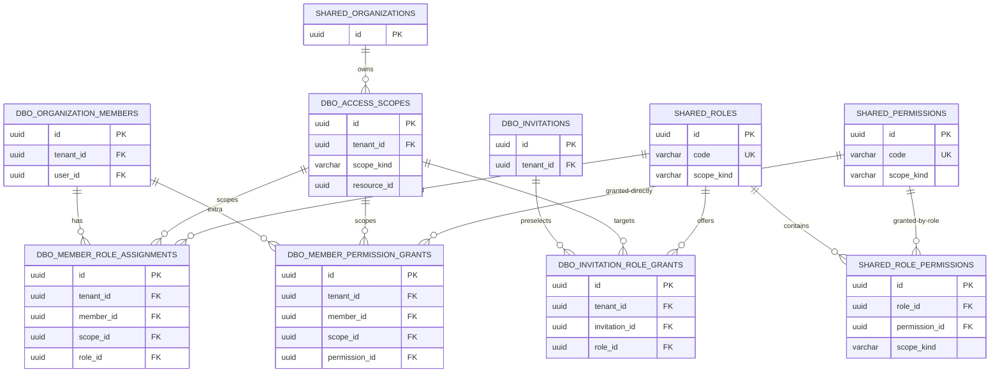

# Identity & Access Module — PostgreSQL 18 ERD and Data Dictionary

**Architecture:** SaaS multi-tenancy, modular monolith, two physical schemas (`shared`, `dbo`), RBAC with scoped, direct user permission grants. **Key format:** `uuid`, generated with PostgreSQL 18 `uuidv7()`. **Status:** proposed architecture and DDL blueprint; not a claim of production migration testing.

## 1. System boundary and ownership

`shared` is for **global platform records**: one account reused across organizations, organization registry, platform-defined permission/role catalogs, credentials, sessions and platform security audit. `dbo` is for **tenant-owned rows**: invitations, organization membership, resource scopes, tenant role assignments, direct permission grants, and tenant audit. There is exactly **one** `dbo` schema with `tenant_id` discriminator: there is **not** a `dbo` schema per tenant.

Identity **does not own** projects, teams, tasks, reviews or employee performance data. Other modules own those aggregates. Their IDs may appear as logical `access_scopes.resource_id` references but are validated by the owning module, not declared as cross-module database foreign keys.

### 1.1 Why separate global users from tenant membership?

A user may belong to multiple organizations and have different permissions in each. Do not create a second login credential for the same person. An `organization_members` row is the identity *within that tenant* and acts as the subject of tenant authorization.

### 1.2 Permission model

- **Global permission catalog:** `shared.permissions` holds code, module, and `scope_kind`.
- **Global role catalog:** `shared.roles` contains reusable built-in roles, such as `organization_owner`, `project_manager`, `team_lead` and `performance_reviewer`.
- **Role-to-permission definition:** `shared.role_permissions` associates a role only with permissions of the same scope kind.
- **Tenant resource scope:** `dbo.access_scopes` identifies organization/project/team/performance resources.
- **Tenant role assignment:** `dbo.member_role_assignments` associates a tenant membership, role and scope.
- **Extra user-specific permissions:** `dbo.member_permission_grants` associates a permission directly with a membership and scope. V1 permits **ALLOW only**; no DENY precedence ambiguity.
- **Platform admin:** `shared.platform_role_assignments` is separate from tenant membership and never implicitly grants tenant business-data access.

Authorization is the union of applicable **active role permissions** and **active direct permission grants** at the requested scope, *then* subject to mandatory checks for active user, active tenant, active membership, active scope, guest restrictions, and module-specific business visibility.

**Important:** There is no automatic inheritance of organization permissions to a project/team/performance scope. For organization-wide capabilities, create a distinct organization-scoped permission such as `project.read_all`, and require the Project module to authorize that capability explicitly. A scope-specific `project.read` grant is not interchangeable with an organization-scoped `project.read_all` grant.

## 2. ERD — global authentication and organization membership



## 3. ERD — RBAC, scopes, direct grants and invitations



> Mermaid conveys logical relationships. Physical FKs, uniqueness and nullability are authoritative in the SQL DDL and tables below. `access_scopes.resource_id` is intentionally a **logical cross-module reference**, not a physical FK.

## 4. PostgreSQL types and assumptions

- `uuid` is a 16-byte binary value; every **table PK** defaults to `uuidv7()` and has a check `uuid_extract_version(id) = 7`.
- `timestamptz` is an 8-byte absolute timestamp; use UTC and format in user's timezone.
- `varchar(n)` limits **characters**, not bytes. Its disk use depends on the actual string. `text` is variable-length and should have app-level limits where indicated.
- Hashes of **opaque high-entropy tokens** are SHA-256 digests (`bytea`, exactly 32 bytes). Passwords use **Argon2id PHC strings**, not SHA-256.
- `inet` stores IPv4 and IPv6 addresses; `jsonb` is used only for bounded security-audit metadata, not normalized RBAC entities.
- Planning volume below assumes **1,000 organizations × 100 memberships = 100,000 memberships**, about **80–100k distinct users**, roughly 10 projects, 5 teams and 2 performance scopes per organization. These are **capacity assumptions**, not measured requirements.
- The data-size column is either a logical upper bound or a typical physical primitive size, **not guaranteed full row storage** (indexes, headers, WAL, MVCC bloat and TOAST are additional).

## 5. Complete table data dictionary

All column names, type widths, defaults and FK definitions are reflected in the accompanying `identity_postgresql18.sql`. Every primary key is `id uuid DEFAULT uuidv7()` with UUID version 7 check.

### 5.1 `shared.users`

Globally unique human identity and non-secret public account attributes.

**Estimated row volume:** 80k–100k accounts. One record per global user; may join multiple organizations.

| Column | PostgreSQL type | Required | Length / physical size | Constraint and meaning |
|---|---|---|---|---|
| `id` | `uuid` | Yes | 16 bytes | PK; UUIDv7 primary key; time-ordered identifier |
| `primary_email` | `varchar(320)` | Yes | ≤ 320 characters | Global login identifier; case-insensitive unique index |
| `display_name` | `varchar(160)` | Yes | ≤ 160 characters | User-facing full/display name |
| `avatar_url` | `text` | No | Unbounded; set app size limits | Link only; keep binary avatars in object storage |
| `locale` | `varchar(16)` | Yes | ≤ 16 characters | UI locale (e.g., en, vi-VN); default `'en'` |
| `time_zone` | `varchar(64)` | Yes | ≤ 64 characters | IANA timezone (e.g., Asia/Ho_Chi_Minh); default `'UTC'` |
| `status` | `varchar(16)` | Yes | ≤ 16 characters | Restricted to the table’s defined lifecycle values; default `'pending'` |
| `email_verified_at` | `timestamptz` | No | 8 bytes | Set after verified email challenge |
| `last_login_at` | `timestamptz` | No | 8 bytes | Last successful authentication (app-managed) |
| `created_at` | `timestamptz` | Yes | 8 bytes | Creation timestamp; database default now() |
| `updated_at` | `timestamptz` | Yes | 8 bytes | Application/EF Core updates on mutation; default covers insert only |

**Important relational, uniqueness and CHECK constraints:** Unique case-insensitive email. Allowed status: pending/active/suspended/deleted. Application normalizes and verifies email.

### 5.2 `shared.organizations`

Global tenant registry. An organization ID is the `tenant_id` on tenant-owned tables.

**Estimated row volume:** 1,000 tenants. Global tenant registry.

| Column | PostgreSQL type | Required | Length / physical size | Constraint and meaning |
|---|---|---|---|---|
| `id` | `uuid` | Yes | 16 bytes | PK; UUIDv7 primary key; time-ordered identifier |
| `slug` | `varchar(80)` | Yes | ≤ 80 characters | Globally unique, URL-friendly organization slug |
| `display_name` | `varchar(200)` | Yes | ≤ 200 characters | User-facing full/display name |
| `status` | `varchar(16)` | Yes | ≤ 16 characters | Restricted to the table’s defined lifecycle values; default `'active'` |
| `created_by_user_id` | `uuid` | Yes | 16 bytes | Global user who created organization; FK → `shared.users.id` |
| `suspended_at` | `timestamptz` | No | 8 bytes | Time organization access was suspended |
| `created_at` | `timestamptz` | Yes | 8 bytes | Creation timestamp; database default now() |
| `updated_at` | `timestamptz` | Yes | 8 bytes | Application/EF Core updates on mutation; default covers insert only |

**Important relational, uniqueness and CHECK constraints:** Unique case-insensitive slug; lowercase alphanumeric/hyphen format; status active/suspended/closed.

### 5.3 `shared.password_credentials`

Local password authentication; PHC formatted Argon2id hash rather than plaintext.

**Estimated row volume:** 60k–100k. Zero or one per password-authenticated user (SSO-only users may have none).

| Column | PostgreSQL type | Required | Length / physical size | Constraint and meaning |
|---|---|---|---|---|
| `id` | `uuid` | Yes | 16 bytes | PK; UUIDv7 primary key; time-ordered identifier |
| `user_id` | `uuid` | Yes | 16 bytes | Unique; FK to the global user or user identity; FK → `shared.users.id` |
| `password_hash` | `varchar(512)` | Yes | ≤ 512 characters | Argon2id PHC string containing algorithm params + salt + hash |
| `failed_attempts` | `integer` | Yes | 4 bytes | Local authentication failures; rate limit independently; default `0` |
| `locked_until` | `timestamptz` | No | 8 bytes | Temporary login lockout deadline |
| `password_changed_at` | `timestamptz` | Yes | 8 bytes | Latest password rotation event; default `now()` |
| `created_at` | `timestamptz` | Yes | 8 bytes | Creation timestamp; database default now() |
| `updated_at` | `timestamptz` | Yes | 8 bytes | Application/EF Core updates on mutation; default covers insert only |

**Important relational, uniqueness and CHECK constraints:** Unique user_id (zero-or-one credential set per user); password hash minimum length; failed_attempts >= 0.

### 5.4 `shared.auth_sessions`

Device/browser sessions; can be revoked independently of organizational memberships.

**Estimated row volume:** 100k–300k active/recent. One record per logged-in device/browser session.

| Column | PostgreSQL type | Required | Length / physical size | Constraint and meaning |
|---|---|---|---|---|
| `id` | `uuid` | Yes | 16 bytes | PK; UUIDv7 primary key; time-ordered identifier |
| `user_id` | `uuid` | Yes | 16 bytes | FK to the global user or user identity; FK → `shared.users.id` |
| `client_ip` | `inet` | No | Variable-length IPv4/IPv6 | Optional network IP (IPv4/IPv6) |
| `user_agent` | `varchar(512)` | No | ≤ 512 characters | Client/browser signature; privacy-sensitive |
| `created_at` | `timestamptz` | Yes | 8 bytes | Creation timestamp; database default now() |
| `last_seen_at` | `timestamptz` | No | 8 bytes | Last session activity (throttle writes) |
| `expires_at` | `timestamptz` | Yes | 8 bytes | Expiration instant; enforce at authorization/token consumption time |
| `revoked_at` | `timestamptz` | No | 8 bytes | Non-null means no longer authorized; retain for audit |

**Important relational, uniqueness and CHECK constraints:** expires_at > created_at; session revocation never precedes creation; FK to users.

### 5.5 `shared.refresh_tokens`

Opaque rotating refresh tokens. Hashes only; reuse of a consumed token revokes its session.

**Estimated row volume:** 300k–3M recent. Grows with rotation frequency; retention cleanup required.

| Column | PostgreSQL type | Required | Length / physical size | Constraint and meaning |
|---|---|---|---|---|
| `id` | `uuid` | Yes | 16 bytes | PK; UUIDv7 primary key; time-ordered identifier |
| `session_id` | `uuid` | Yes | 16 bytes | FK to the device/browser session; FK → `shared.auth_sessions.id` |
| `token_hash` | `bytea` | Yes | 32 bytes for token hashes | Unique; SHA-256 digest of high-entropy opaque token; never store raw token |
| `replaced_by_token_id` | `uuid` | No | 16 bytes | Optional self-reference to rotated successor token; FK → `shared.refresh_tokens.id` |
| `issued_at` | `timestamptz` | Yes | 8 bytes | Refresh-token issuance timestamp; default `now()` |
| `expires_at` | `timestamptz` | Yes | 8 bytes | Expiration instant; enforce at authorization/token consumption time |
| `consumed_at` | `timestamptz` | No | 8 bytes | Marks one-time token or refresh token as already used |
| `revoked_at` | `timestamptz` | No | 8 bytes | Non-null means no longer authorized; retain for audit |

**Important relational, uniqueness and CHECK constraints:** 32-byte token hash is globally unique; session FK; optional replacement self-FK; expiry after issue; replacement unique.

### 5.6 `shared.one_time_tokens`

Hashed one-time challenge tokens for verification and password reset.

**Estimated row volume:** 1k–20k recent. Short-lived password-reset/email-verification tokens.

| Column | PostgreSQL type | Required | Length / physical size | Constraint and meaning |
|---|---|---|---|---|
| `id` | `uuid` | Yes | 16 bytes | PK; UUIDv7 primary key; time-ordered identifier |
| `user_id` | `uuid` | Yes | 16 bytes | FK to the global user or user identity; FK → `shared.users.id` |
| `purpose` | `varchar(24)` | Yes | ≤ 24 characters | Restricted one-time token purpose |
| `token_hash` | `bytea` | Yes | 32 bytes for token hashes | Unique; SHA-256 digest of high-entropy opaque token; never store raw token |
| `created_at` | `timestamptz` | Yes | 8 bytes | Creation timestamp; database default now() |
| `expires_at` | `timestamptz` | Yes | 8 bytes | Expiration instant; enforce at authorization/token consumption time |
| `consumed_at` | `timestamptz` | No | 8 bytes | Marks one-time token or refresh token as already used |

**Important relational, uniqueness and CHECK constraints:** 32-byte globally unique token hash; purpose limited to verify_email/reset_password; expiry after creation.

### 5.7 `shared.permissions`

Global permission catalogue. Each permission belongs to exactly one authorization scope kind.

**Estimated row volume:** 100–300. Platform-managed seeded catalog.

| Column | PostgreSQL type | Required | Length / physical size | Constraint and meaning |
|---|---|---|---|---|
| `id` | `uuid` | Yes | 16 bytes | PK; UUIDv7 primary key; time-ordered identifier |
| `code` | `varchar(120)` | Yes | ≤ 120 characters | Unique; Stable, unique code for RBAC metadata |
| `module` | `varchar(40)` | Yes | ≤ 40 characters | Owning application bounded context |
| `scope_kind` | `varchar(24)` | Yes | ≤ 24 characters | Scope classification, checked across composite foreign keys |
| `description` | `varchar(500)` | Yes | ≤ 500 characters | Readable definition, not used as permission identifier |
| `is_sensitive` | `boolean` | Yes | 1 byte | Flags permission for elevated grant review/auditing; default `false` |
| `is_active` | `boolean` | Yes | 1 byte | Whether definition remains eligible for use; default `true` |
| `created_at` | `timestamptz` | Yes | 8 bytes | Creation timestamp; database default now() |

**Important relational, uniqueness and CHECK constraints:** Unique code; unique (id, scope_kind) to support scope-matching composite FKs; validated scope-kind set.

### 5.8 `shared.roles`

Global built-in role definitions scoped to platform, organization, project, team or performance.

**Estimated row volume:** 12–30. Global built-in role definitions.

| Column | PostgreSQL type | Required | Length / physical size | Constraint and meaning |
|---|---|---|---|---|
| `id` | `uuid` | Yes | 16 bytes | PK; UUIDv7 primary key; time-ordered identifier |
| `code` | `varchar(80)` | Yes | ≤ 80 characters | Unique; Stable, unique code for RBAC metadata |
| `display_name` | `varchar(120)` | Yes | ≤ 120 characters | User-facing full/display name |
| `scope_kind` | `varchar(24)` | Yes | ≤ 24 characters | Scope classification, checked across composite foreign keys |
| `description` | `varchar(500)` | No | ≤ 500 characters | Readable definition, not used as permission identifier |
| `is_assignable` | `boolean` | Yes | 1 byte | Whether administrators may assign this built-in role; default `true` |
| `is_active` | `boolean` | Yes | 1 byte | Whether definition remains eligible for use; default `true` |
| `created_at` | `timestamptz` | Yes | 8 bytes | Creation timestamp; database default now() |

**Important relational, uniqueness and CHECK constraints:** Unique code; unique (id, scope_kind); all roles are platform-defined and reusable by tenants.

### 5.9 `shared.role_permissions`

Many-to-many association defining what each role grants.

**Estimated row volume:** 100–1,000. Static seeded role–permission mapping.

| Column | PostgreSQL type | Required | Length / physical size | Constraint and meaning |
|---|---|---|---|---|
| `id` | `uuid` | Yes | 16 bytes | PK; UUIDv7 primary key; time-ordered identifier |
| `role_id` | `uuid` | Yes | 16 bytes | FK to shared.roles with matching scope_kind |
| `permission_id` | `uuid` | Yes | 16 bytes | FK to shared.permissions with matching scope_kind |
| `scope_kind` | `varchar(24)` | Yes | ≤ 24 characters | Scope classification, checked across composite foreign keys |
| `created_at` | `timestamptz` | Yes | 8 bytes | Creation timestamp; database default now() |

**Important relational, uniqueness and CHECK constraints:** Unique (role_id, permission_id); two composite FKs ensure the role and permission share the same scope_kind.

### 5.10 `shared.platform_role_assignments`

Platform-wide role assignment to a global user. Never implies automatic tenant data access.

**Estimated row volume:** 10–100. Very low volume of platform administrators.

| Column | PostgreSQL type | Required | Length / physical size | Constraint and meaning |
|---|---|---|---|---|
| `id` | `uuid` | Yes | 16 bytes | PK; UUIDv7 primary key; time-ordered identifier |
| `user_id` | `uuid` | Yes | 16 bytes | FK to the global user or user identity; FK → `shared.users.id` |
| `role_id` | `uuid` | Yes | 16 bytes | FK to shared.roles with matching scope_kind |
| `scope_kind` | `varchar(24)` | Yes | ≤ 24 characters | Scope classification, checked across composite foreign keys; default `'platform'` |
| `assigned_by_user_id` | `uuid` | No | 16 bytes | Global platform user who granted platform role; FK → `shared.users.id` |
| `assigned_at` | `timestamptz` | Yes | 8 bytes | Role assignment creation time; default `now()` |
| `revoked_at` | `timestamptz` | No | 8 bytes | Non-null means no longer authorized; retain for audit |

**Important relational, uniqueness and CHECK constraints:** CHECK scope_kind=platform; matching shared.roles FK; only one unrevoked user/role pairing.

### 5.11 `dbo.organization_members`

An account’s membership in a specific organization, including guest, contractor, and employee classification.

**Estimated row volume:** 100k. 100 members × 1,000 organizations.

| Column | PostgreSQL type | Required | Length / physical size | Constraint and meaning |
|---|---|---|---|---|
| `id` | `uuid` | Yes | 16 bytes | PK; UUIDv7 primary key; time-ordered identifier |
| `tenant_id` | `uuid` | Yes | 16 bytes | Organization ID; tenant boundary and indexed FK; FK → `shared.organizations.id` |
| `user_id` | `uuid` | Yes | 16 bytes | FK to the global user or user identity; FK → `shared.users.id` |
| `membership_type` | `varchar(12)` | Yes | ≤ 12 characters | employee, contractor or guest classification; default `'employee'` |
| `status` | `varchar(16)` | Yes | ≤ 16 characters | Restricted to the table’s defined lifecycle values; default `'active'` |
| `joined_at` | `timestamptz` | Yes | 8 bytes | Membership activation timestamp; default `now()` |
| `removed_at` | `timestamptz` | No | 8 bytes | Non-null only for removed membership |
| `created_at` | `timestamptz` | Yes | 8 bytes | Creation timestamp; database default now() |
| `updated_at` | `timestamptz` | Yes | 8 bytes | Application/EF Core updates on mutation; default covers insert only |

**Important relational, uniqueness and CHECK constraints:** Unique (tenant_id, user_id); unique (tenant_id, id) for composite FKs; CHECK removed_at matches removed status; FK to global user/tenant.

### 5.12 `dbo.access_scopes`

Authorization resources for organization, project, team and performance domains.

**Estimated row volume:** 18k–25k. Per tenant: organization + projects + teams + performance scopes.

| Column | PostgreSQL type | Required | Length / physical size | Constraint and meaning |
|---|---|---|---|---|
| `id` | `uuid` | Yes | 16 bytes | PK; UUIDv7 primary key; time-ordered identifier |
| `tenant_id` | `uuid` | Yes | 16 bytes | Organization ID; tenant boundary and indexed FK; FK → `shared.organizations.id` |
| `scope_kind` | `varchar(24)` | Yes | ≤ 24 characters | Scope classification, checked across composite foreign keys |
| `resource_id` | `uuid` | Yes | 16 bytes | External domain aggregate ID; owner module validates tenant/existence |
| `status` | `varchar(12)` | Yes | ≤ 12 characters | Restricted to the table’s defined lifecycle values; default `'active'` |
| `created_at` | `timestamptz` | Yes | 8 bytes | Creation timestamp; database default now() |
| `archived_at` | `timestamptz` | No | 8 bytes | End of authorization scope lifecycle |

**Important relational, uniqueness and CHECK constraints:** Unique (tenant_id, scope_kind, resource_id); unique (tenant_id, id, scope_kind) for FKs; organization scope has resource_id=tenant_id.

### 5.13 `dbo.invitations`

One-use organization invitations with hashed secret and lifecycle status.

**Estimated row volume:** 20k–50k/year. Depends on staff/client onboarding and reinvitations.

| Column | PostgreSQL type | Required | Length / physical size | Constraint and meaning |
|---|---|---|---|---|
| `id` | `uuid` | Yes | 16 bytes | PK; UUIDv7 primary key; time-ordered identifier |
| `tenant_id` | `uuid` | Yes | 16 bytes | Organization ID; tenant boundary and indexed FK; FK → `shared.organizations.id` |
| `invitee_email` | `varchar(320)` | Yes | ≤ 320 characters | Target address for invitation; case-insensitive active uniqueness |
| `membership_type` | `varchar(12)` | Yes | ≤ 12 characters | employee, contractor or guest classification; default `'employee'` |
| `token_hash` | `bytea` | Yes | 32 bytes for token hashes | Unique; SHA-256 digest of high-entropy opaque token; never store raw token |
| `status` | `varchar(16)` | Yes | ≤ 16 characters | Restricted to the table’s defined lifecycle values; default `'pending'` |
| `invited_by_member_id` | `uuid` | Yes | 16 bytes | Composite FK to inviter in same tenant |
| `accepted_by_user_id` | `uuid` | No | 16 bytes | User who accepted invitation; must match verified invite email; FK → `shared.users.id` |
| `created_at` | `timestamptz` | Yes | 8 bytes | Creation timestamp; database default now() |
| `expires_at` | `timestamptz` | Yes | 8 bytes | Expiration instant; enforce at authorization/token consumption time |
| `accepted_at` | `timestamptz` | No | 8 bytes | Successful invite redemption time |
| `revoked_at` | `timestamptz` | No | 8 bytes | Non-null means no longer authorized; retain for audit |

**Important relational, uniqueness and CHECK constraints:** Unique unaccepted/pending invite email per tenant (case insensitive); global unique hashed token; composite FK to inviter membership.

### 5.14 `dbo.invitation_role_grants`

Preselected scoped roles to apply atomically when an invitation is accepted.

**Estimated row volume:** 30k–100k/year. Typically 1–3 scoped roles per invitation.

| Column | PostgreSQL type | Required | Length / physical size | Constraint and meaning |
|---|---|---|---|---|
| `id` | `uuid` | Yes | 16 bytes | PK; UUIDv7 primary key; time-ordered identifier |
| `tenant_id` | `uuid` | Yes | 16 bytes | Organization ID; tenant boundary and indexed FK; FK → `shared.organizations.id` |
| `invitation_id` | `uuid` | Yes | 16 bytes | Composite FK to invitation in same tenant |
| `scope_id` | `uuid` | Yes | 16 bytes | FK to tenant authorization scope (with tenant and kind) |
| `scope_kind` | `varchar(24)` | Yes | ≤ 24 characters | Scope classification, checked across composite foreign keys |
| `role_id` | `uuid` | Yes | 16 bytes | FK to shared.roles with matching scope_kind |
| `created_at` | `timestamptz` | Yes | 8 bytes | Creation timestamp; database default now() |

**Important relational, uniqueness and CHECK constraints:** Unique (tenant_id, invitation_id, scope_id, role_id); composite FKs enforce same tenant and same scope-kind role.

### 5.15 `dbo.member_role_assignments`

Tenant-scoped RBAC role assignments for human organization members.

**Estimated row volume:** 150k–300k active. Typically 1–3 active roles per membership.

| Column | PostgreSQL type | Required | Length / physical size | Constraint and meaning |
|---|---|---|---|---|
| `id` | `uuid` | Yes | 16 bytes | PK; UUIDv7 primary key; time-ordered identifier |
| `tenant_id` | `uuid` | Yes | 16 bytes | Organization ID; tenant boundary and indexed FK; FK → `shared.organizations.id` |
| `member_id` | `uuid` | Yes | 16 bytes | FK to organization membership in same tenant |
| `scope_id` | `uuid` | Yes | 16 bytes | FK to tenant authorization scope (with tenant and kind) |
| `scope_kind` | `varchar(24)` | Yes | ≤ 24 characters | Scope classification, checked across composite foreign keys |
| `role_id` | `uuid` | Yes | 16 bytes | FK to shared.roles with matching scope_kind |
| `assigned_by_member_id` | `uuid` | No | 16 bytes | Member who assigned the role; system bootstrap may be null |
| `reason` | `varchar(300)` | No | ≤ 300 characters | Human-readable reason for temporary role assignment |
| `assigned_at` | `timestamptz` | Yes | 8 bytes | Role assignment creation time; default `now()` |
| `expires_at` | `timestamptz` | No | 8 bytes | Expiration instant; enforce at authorization/token consumption time |
| `revoked_at` | `timestamptz` | No | 8 bytes | Non-null means no longer authorized; retain for audit |

**Important relational, uniqueness and CHECK constraints:** Unique unrevoked (tenant_id, member_id, scope_id, role_id); composite member/scope FKs protect tenant boundaries; role scope FK.

### 5.16 `dbo.member_permission_grants`

Individual user extra permissions (ALLOW grants only), scoped to a resource.

**Estimated row volume:** 5k–20k active. Exception grants, not the normal access path.

| Column | PostgreSQL type | Required | Length / physical size | Constraint and meaning |
|---|---|---|---|---|
| `id` | `uuid` | Yes | 16 bytes | PK; UUIDv7 primary key; time-ordered identifier |
| `tenant_id` | `uuid` | Yes | 16 bytes | Organization ID; tenant boundary and indexed FK; FK → `shared.organizations.id` |
| `member_id` | `uuid` | Yes | 16 bytes | FK to organization membership in same tenant |
| `scope_id` | `uuid` | Yes | 16 bytes | FK to tenant authorization scope (with tenant and kind) |
| `scope_kind` | `varchar(24)` | Yes | ≤ 24 characters | Scope classification, checked across composite foreign keys |
| `permission_id` | `uuid` | Yes | 16 bytes | FK to shared.permissions with matching scope_kind |
| `granted_by_member_id` | `uuid` | No | 16 bytes | Member who authorized direct grant; system bootstrap may be null |
| `justification` | `varchar(500)` | Yes | ≤ 500 characters | Required justification for exceptional permission grant |
| `granted_at` | `timestamptz` | Yes | 8 bytes | Time direct permission was granted; default `now()` |
| `expires_at` | `timestamptz` | No | 8 bytes | Expiration instant; enforce at authorization/token consumption time |
| `revoked_at` | `timestamptz` | No | 8 bytes | Non-null means no longer authorized; retain for audit |

**Important relational, uniqueness and CHECK constraints:** Unique unrevoked (tenant_id, member_id, scope_id, permission_id); composite member/scope FKs; permission scope FK; justification mandatory.

### 5.17 `dbo.security_audit_events`

Immutable security event history for tenant membership, access and credential changes.

**Estimated row volume:** ~1.5M/month baseline. At 0.5 security events/member/day; can be considerably higher.

| Column | PostgreSQL type | Required | Length / physical size | Constraint and meaning |
|---|---|---|---|---|
| `id` | `uuid` | Yes | 16 bytes | PK; UUIDv7 primary key; time-ordered identifier |
| `tenant_id` | `uuid` | Yes | 16 bytes | Organization ID; tenant boundary and indexed FK; FK → `shared.organizations.id` |
| `actor_user_id` | `uuid` | No | 16 bytes | Historical actor; not FK to permit account erasure |
| `actor_member_id` | `uuid` | No | 16 bytes | Historical actor membership in tenant |
| `event_code` | `varchar(100)` | Yes | ≤ 100 characters | Structured event identifier, e.g. identity.role.assigned |
| `target_type` | `varchar(80)` | Yes | ≤ 80 characters | Type of affected resource; not a polymorphic FK |
| `target_id` | `uuid` | No | 16 bytes | Identifier of affected resource when available |
| `success` | `boolean` | Yes | 1 byte | Outcome flag (true/false); default `true` |
| `client_ip` | `inet` | No | Variable-length IPv4/IPv6 | Optional network IP (IPv4/IPv6) |
| `correlation_id` | `uuid` | No | 16 bytes | Request/trace correlation UUID, not necessarily UUIDv7 |
| `details` | `jsonb` | Yes | Variable; suggest <= 4 KB/event | Small JSON object of non-secret, scrubbed event metadata; default `'{}'::jsonb` |
| `occurred_at` | `timestamptz` | Yes | 8 bytes | Recorded event time; index for retention and querying |

**Important relational, uniqueness and CHECK constraints:** FK tenant_id; append-only via database role and service policy; JSON object shape; no FK on historical actor IDs.

### 5.18 `shared.platform_security_audit_events`

Platform administration security events, including tenant suspension.

**Estimated row volume:** 1k–20k/year. Platform-wide administrative security events.

| Column | PostgreSQL type | Required | Length / physical size | Constraint and meaning |
|---|---|---|---|---|
| `id` | `uuid` | Yes | 16 bytes | PK; UUIDv7 primary key; time-ordered identifier |
| `actor_user_id` | `uuid` | No | 16 bytes | Historical actor; not FK to permit account erasure |
| `target_tenant_id` | `uuid` | No | 16 bytes | Tenant affected by a platform event; nullable; FK → `shared.organizations.id` |
| `event_code` | `varchar(100)` | Yes | ≤ 100 characters | Structured event identifier, e.g. identity.role.assigned |
| `target_type` | `varchar(80)` | Yes | ≤ 80 characters | Type of affected resource; not a polymorphic FK |
| `target_id` | `uuid` | No | 16 bytes | Identifier of affected resource when available |
| `success` | `boolean` | Yes | 1 byte | Outcome flag (true/false); default `true` |
| `client_ip` | `inet` | No | Variable-length IPv4/IPv6 | Optional network IP (IPv4/IPv6) |
| `correlation_id` | `uuid` | No | 16 bytes | Request/trace correlation UUID, not necessarily UUIDv7 |
| `details` | `jsonb` | Yes | Variable; suggest <= 4 KB/event | Small JSON object of non-secret, scrubbed event metadata; default `'{}'::jsonb` |
| `occurred_at` | `timestamptz` | Yes | 8 bytes | Recorded event time; index for retention and querying |

**Important relational, uniqueness and CHECK constraints:** Optional FK target_tenant_id; append-only policy; JSON object shape; no actor FK to permit privacy erasure.

## 6. Explicit composite FK strategy (cross-tenant protection)

Every table in `dbo` has a non-null `tenant_id`. The following compound keys intentionally repeat the tenant discriminator:

```sql
-- Parent exposes a composite UNIQUE key, in addition to UUIDv7 PK:
UNIQUE (tenant_id, id)

-- Example: assign role only to a member of the same tenant:
FOREIGN KEY (tenant_id, member_id)
  REFERENCES dbo.organization_members (tenant_id, id)

-- Ensure role and access scope have the same scope type:
FOREIGN KEY (tenant_id, scope_id, scope_kind)
  REFERENCES dbo.access_scopes (tenant_id, id, scope_kind)
FOREIGN KEY (role_id, scope_kind)
  REFERENCES shared.roles (id, scope_kind)

-- For direct grants, substitute shared.permissions for shared.roles:
FOREIGN KEY (permission_id, scope_kind)
  REFERENCES shared.permissions (id, scope_kind)
```

These constraints eliminate a class of data-corruption bugs: a row claiming `tenant_id=A` cannot reference a membership/scope belonging to tenant `B`, even if an application accidentally supplies a UUID of an object from another organization. This does **not** replace API authorization; a valid but unauthorized assignment still requires application checks.

**Lifecycle invariants enforced in the application:** 1 active owner per organization at minimum; a membership must be active before its grants work; roles/permissions must be assignable and active; scope creation/archiving follows owning business module lifecycle; invitations require verified recipient identity; guest data cannot receive confidential performance access; `expires_at` is checked at access time, not only on writes.

## 7. Default seeded roles and permission examples

| Role code (`shared.roles`) | Kind | Example permission codes | Who uses it |
|---|---|---|---|
| `platform_admin` | platform | `platform.tenants.suspend`, `platform.audit.read` | SaaS operator |
| `organization_owner` | organization | `organization.members.manage`, `organization.settings.manage`, `project.read_all` | Company owner |
| `organization_admin` | organization | `organization.members.invite`, `organization.members.manage` | Tenant admin |
| `organization_member` | organization | `organization.profile.read` | Employee |
| `organization_guest` | organization | `organization.profile.read_limited` | External client |
| `project_manager` | project | `project.read`, `project.update`, `task.assign` | PM |
| `project_contributor` | project | `project.read`, `task.create`, `task.update` | Developer/QA |
| `project_viewer` | project | `project.read`, `task.read` | Client reviewer |
| `team_lead` | team | `team.read`, `team.members.manage` | Engineering manager |
| `team_member` | team | `team.read` | Employee |
| `performance_reviewer` | performance | `performance.review.read_assigned`, `performance.review.submit` | Authorized reviewer |
| `performance_hr_admin` | organization | `performance.cycles.manage` | HR admin |

**Seed rules:** All permission codes and roles are examples for product analysis, not mandated APIs. `shared.permissions.scope_kind` must match role scope. In particular, `performance.review.read_assigned` must still be checked against the actual reviewer's assignment and review visibility state in the Performance module. Avoid blanket privileges such as `performance.*` for general organization administrators.

## 8. Worked example: a developer with an additional permission

User **Charlie** has a global `shared.users` account and is an active `dbo.organization_members` member of NovaTech.

1. NovaTech has a Banking API project; Identity registers `access_scopes(tenant_id=NovaTech, scope_kind=project, resource_id=BankingAPIId)`.
2. Charlie receives the built-in `project_contributor` role for that exact `scope_id` via `member_role_assignments`.
3. The Product/Project owner temporarily authorizes Charlie to trigger production release workflows. The access administrator adds a `member_permission_grants` row with permission `project.release.trigger`, the **same project scope**, and a non-null justification and expiration.
4. An authorization check for `task.update` succeeds through the role. `project.release.trigger` succeeds through the **direct grant** even if the contributor role does not contain it.
5. Charlie does **not** gain release permissions in other projects or organizations. If his membership is suspended, the resource is archived, the grant is revoked, or its expiration passes, access fails.

No explicit DENY rows in V1. If an employee needs fewer capabilities than a role gives, assign a narrower role; later a carefully specified direct DENY model can be added if a genuine business case demands it.

## 9. Authorization evaluation algorithm

```text
Authorize(userId, tenantId, permissionCode, targetScopeId):
    reject unless global user is active, global tenant is active
    load tenant membership; reject unless active
    resolve scope; reject unless scope belongs to tenant and is active
    reject if action violates hard guest/security restrictions

    matching role permissions =
       active, unrevoked, unexpired role assignments of member at scope
       -> active role definitions -> role_permissions -> permission code

    matching direct grants =
       unrevoked, unexpired direct permission grants of member at scope
       -> active permission definition -> permission code

    reject unless (matching role permissions OR matching direct grants)
    finally enforce owning-module resource rules (project membership rules,
       assignee constraints, confidential review visibility, etc.)
```

For an organization-wide permission such as `project.read_all`, the Project module must **explicitly** test the organization's authorization scope and corresponding permission instead of assuming its own project scope automatically inherits it.

**Security:** Never authorize from JWT role claims alone if immediate revocation matters; either query current grants or use a versioned short-lived authorization cache invalidated on change. Only permit granting permissions a requesting administrator is authorized to delegate (prevent privilege escalation).

## 10. PostgreSQL indexes, retention and concurrency

| Table | Key index / query | Why |
|---|---|---|
| `shared.users` | Unique `lower(primary_email)` | Case-insensitive global login |
| `shared.organizations` | Unique `lower(slug)` | Stable tenant lookup |
| `dbo.organization_members` | Unique `(tenant_id,user_id)`, index `(tenant_id,status)` | Tenant/user lookup and employee lists |
| `dbo.access_scopes` | Unique `(tenant_id,scope_kind,resource_id)` | Resolve a resource to authorization scope |
| `dbo.member_role_assignments` | Partial unique `(tenant_id,member_id,scope_id,role_id) WHERE revoked_at IS NULL` | No duplicate active grant; member access lookups |
| `dbo.member_permission_grants` | Partial unique `(tenant_id,member_id,scope_id,permission_id) WHERE revoked_at IS NULL` | No duplicate active direct permission |
| `dbo.invitations` | Partial unique `(tenant_id,lower(invitee_email)) WHERE status='pending'` | Prevent duplicate live invitation workflow |
| `shared.refresh_tokens` | Unique `token_hash`; `(session_id,issued_at DESC)` | Fast token lookup and replay detection |
| `dbo.security_audit_events` | `(tenant_id,occurred_at DESC)` | Chronological tenant security investigations |

**Partial unique caveat:** An expired grant with `revoked_at IS NULL` still occupies the partial unique index. Refresh/replace the existing grant or mark it revoked before creating a new row. Likewise, a pending invitation whose expiration passes must be transitioned to `expired` before reinviting the same email.

**Audit growth:** At 1.5M events/month, set a retention policy and consider monthly partitioning or an append-only audit store as operational requirements grow. If partitioning by `occurred_at` in PostgreSQL, primary/unique keys must include the partition key; plan that migration explicitly rather than pretending an unmodified `PRIMARY KEY(id)` will work. Don't indiscriminately partition small RBAC tables.

**Performance:** Do not query `shared.permissions` and `shared.role_permissions` for every call if their seeded mapping is stable. Cache role definitions in-process; cache compiled effective grants briefly only if revocation/version invalidation is correct. Use indexed, tenant-specific joins; avoid fetching every role and evaluating thousands of permissions in the application. Use transactions and unique constraints for concurrent invite redemption/role assignment.

## 11. Row-Level Security (defense in depth)

The SQL blueprint enables and forces PostgreSQL RLS for every `dbo` table using tenant-aware policies:

```sql
ALTER TABLE dbo.member_role_assignments ENABLE ROW LEVEL SECURITY;
ALTER TABLE dbo.member_role_assignments FORCE ROW LEVEL SECURITY;
CREATE POLICY tenant_isolation ON dbo.member_role_assignments
  USING (tenant_id = nullif(current_setting('app.tenant_id', true), '')::uuid)
  WITH CHECK (tenant_id = nullif(current_setting('app.tenant_id', true), '')::uuid);
```

For application use, assign the **trusted** `app.tenant_id` setting with `SET LOCAL` *inside* the same SQL transaction as the query. A missing tenant setting yields no tenant rows. Do not execute app traffic as table owner/superuser or a role with `BYPASSRLS`; do not let untrusted clients issue arbitrary SQL or tenant-setting commands. The setting is a defense against query mistakes, **not proof of the caller's entitlement to the tenant**. Bootstrap and cross-tenant administration require carefully audited privileged flows.

`shared` sensitive data needs independent service-layer authorization and database privileges; it is **not** globally visible merely because it is shared across tenants.

## 12. Security and data-life-cycle policies

- **Passwords:** Argon2id with tuned parameters. Store only PHC strings; never plaintext. Keep SSO accounts without password rows.
- **Refresh rotation:** Generate cryptographically random opaque tokens, hash with SHA-256, atomically mark old token consumed and insert its successor; reuse detection revokes the session/family. Ensure token rotation concurrency is controlled transactionally.
- **Invitations:** Hash the invitation secret, verify recipient ownership, verify expiry, accept once in a transaction, create or reactivate the membership, and apply planned role grants.
- **Deactivation:** Deactivate/suspend instead of cascading deletion; reject all authorization for inactive tenant membership; revoke relevant sessions/tokens if required. Historical audit and task attribution should be preserved under retention policy.
- **Sensitive data:** Keep IP and user agent only as long as security requirements justify. Limit audit JSON size and never store secrets or confidential review contents in it.
- **Audit tamper controls:** Separate append-only database role, deny UPDATE/DELETE to app role, and use archival/retention operations through privileged channels.
- **Race conditions:** Use transactions/locking for last-owner removal prevention, invitations, refresh rotation and competing permission grants. A partial unique index alone is not a complete business workflow.
- **Timestamps:** Defaults only populate on INSERT. `updated_at` updates must be supplied by EF Core interceptors or a database trigger.

## 13. What deliberately stays outside Identity?

| Domain/module | Business tables NOT in this ERD | Relationship with Identity |
|---|---|---|
| Organization | Company profile/settings and subscription | `shared.organizations.id` is stable tenant anchor; module extension tables may reference it |
| Team Management | `teams`, `team_members`, reporting relationships | `access_scopes` logical `team` resource ID, module validates team ownership |
| Project Management | `projects`, project participants and portfolio data | `access_scopes` logical `project` resource ID; project domain owns existence/lifecycle |
| Task Management | `work_items`, assignments, comments | Checks caller's appropriate project scope and task business rules |
| Performance | `review_cycles`, `employee_reviews`, feedback and evaluations | Performance-scoped grants **plus** review-specific visibility checks |
| KPI/OKR | Objectives, key results, metrics, KPI measurements | Module-specific permissions and metric ownership |

## 14. Extensions to add when actual requirements appear

- **Corporate SSO:** `shared.external_identities` (`user_id`, provider, subject, issuer, lifecycle) and an OIDC/SAML flow. Add SCIM provisioning later.
- **Organization-specific custom roles:** `dbo.custom_roles` and `dbo.custom_role_permissions` with tenant composite FKs. Do not mix those with `shared.roles` through a single nullable polymorphic `role_id`; revise the grant target model deliberately.
- **Service accounts/AI agents:** `dbo.service_accounts`, `dbo.service_account_api_keys`, and scoped service-account grants. Use independent keys/identities, never a human employee's refresh token. Audit actions as the service principal and initiating human where applicable.
- **MFA/passkeys:** `shared.authenticators`, recovery code hashes, credential enrollment and challenge lifecycle.
- **Role/permission change history:** If seeded role definitions are mutated, log change events and invalidate authorization caches; use migrations for catalog changes.

## 15. Acceptance checklist

- [ ] Alice's global user can be a member of two tenants without duplicate credentials.
- [ ] A tenant-A role assignment cannot reference a tenant-B member or access scope (composite FKs).
- [ ] A project role cannot be assigned against an organization/team/performance scope (scope-kind composite FKs).
- [ ] Direct user grants add permission only at the specified scope; no unexpected inheritance.
- [ ] Suspended memberships, revoked grants and expired grants are denied immediately.
- [ ] Guests cannot bypass restricted business information through role/direct permissions.
- [ ] Platform administrators cannot read tenant data merely because they have platform roles.
- [ ] Tokens are hashed, rotated, and cannot be reused; no raw secrets in audit.
- [ ] Last tenant owner cannot be removed/suspended without a valid replacement.
- [ ] Tenant-scoped queries are covered by RLS and application-level authorization.
- [ ] Domain scope creation/deletion/revocation is consistent with the owning module.

## References

- PostgreSQL 18 native UUIDv7 and extraction: https://www.postgresql.org/docs/18/functions-uuid.html
- PostgreSQL constraints and composite foreign keys: https://www.postgresql.org/docs/18/ddl-constraints.html
- PostgreSQL unique indexes and partial uniqueness: https://www.postgresql.org/docs/18/indexes-unique.html
- PostgreSQL row-level security: https://www.postgresql.org/docs/18/ddl-rowsecurity.html
- PostgreSQL string type storage: https://www.postgresql.org/docs/18/datatype-character.html

**SQL design companion:** `identity_postgresql18.sql`.
